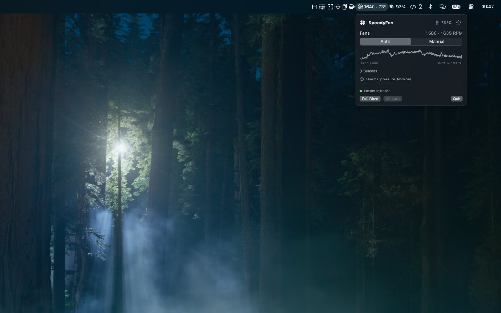
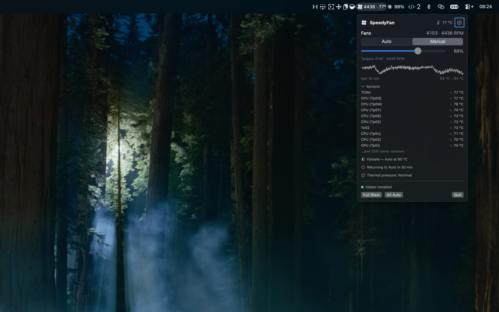
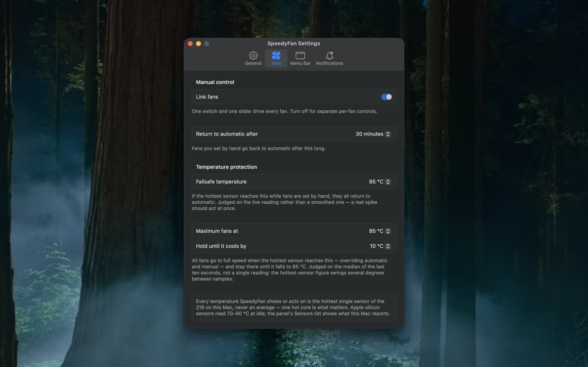

<p align="center">
  
</p>

<h1 align="center">SpeedyFan</h1>

A macOS menu bar app for monitoring and controlling the fans in Apple Silicon
Macs. Live RPM and temperatures in a popup panel, and each fan — or all of them
at once — switchable between the firmware's automatic control and a manual
speed.

<p align="center">
  
</p>

## Features

- **Fan control** — set any fan to **Auto** or **Manual** at a fixed RPM,
  always clamped to that fan's own min–max range. **Link Fans** drives every
  fan from a single 0–100 % slider; turn it off for per-fan sliders. Changes
  apply live, plus one-click **Full Blast** and **All Auto** presets.
- **Menu bar readings** — show any combination of fan icon, RPM, speed as a
  percentage, and the hottest sensor temperature, refreshed every 1–20 s. The
  icon doubles as a status light: outline for automatic, filled for a manual
  pin, flame while the heat boost is holding.
- **Temperatures** — a hottest-sensor summary, a ten-minute sparkline, and a
  collapsible list of the ~200 individual sensors with rising/falling trend
  arrows. Celsius, Fahrenheit, or whatever your region uses.
- **Thermal pressure** — macOS's own heat verdict (Nominal / Fair / Serious /
  Critical), which bakes in Apple's per-model knowledge of what counts as hot.
- **Maximum Fans At** — optionally drive every fan to maximum when the hottest
  sensor hits a trigger temperature (85–100 °C), holding until it cools 10–25 °C
  below. Off by default.
- **Return to Automatic After** — an optional 15 / 30 / 60-minute timer that
  ends manual control on its own.
- **Launch at Login**, a hideable menu bar icon, and per-category notification
  settings.
- **Light on the machine** — with the panel closed and no menu bar readings
  selected, the app doesn't poll the hardware at all.

<p align="center">
  
</p>

## Requirements

macOS 13 or later. Developed and tested on Apple Silicon; Intel Macs are
untested but may largely work.

## Install

```sh
brew tap n14395/tap
brew install --cask speedy-fan
```

Or download the `.dmg` from [Releases](https://github.com/n14395/speedy-fan/releases)
and drag SpeedyFan to Applications.

### Building from source

```sh
./build.sh                 # build build/SpeedyFan.app
./build.sh --dmg           # ...and package it as build/SpeedyFan.dmg
./build.sh --sign          # ...Developer ID sign, notarize and staple
./build.sh --publish v1.2  # tag, push and cut a GitHub release
swift test                 # run the tests
```

Building needs full Xcode — the bare Command Line Tools are missing the SwiftUI
macro plugins. `build.sh` finds `/Applications/Xcode.app` or `Xcode-beta.app`
automatically. The app icon is generated by `tools/make-icon.swift` whenever
`AppIcon.icns` is missing.

## The privileged helper

Reading the SMC needs no privileges, but **writing to it needs root**. On your
first manual fan change, SpeedyFan installs a small helper CLI (`fanctl`) to
`/Library/PrivilegedHelperTools/com.n14395.SpeedyFan.fanctl` as setuid-root. That's one
admin password prompt, after which fan changes apply silently.

The settings window shows the install status and offers **Install**, **Update**
or **Uninstall Helper**. Updating the app doesn't automatically update the
installed helper, so SpeedyFan compares the two by content digest and offers
**Update Helper** when they actually differ.

## Safety

Pinning a fan is only worth having if it can't end badly, so the supervision
isn't optional:

- Manual speeds are always clamped to the fan's own `[min, max]` range.
- A **thermal failsafe** (85–100 °C, default 95) forces everything back to Auto,
  with an alert, if any sensor gets that hot while a fan is pinned.
- A **stuck-fan alert** fires when a fan is commanded to a real speed but
  reports essentially no rotation for 30 seconds.
- **Sleep** hands the fans back to the firmware on the way down — the SMC keeps
  its last order through sleep, so a pinned fan would otherwise run all night
  unsupervised. Wake restores whatever was pinned.
- **Quitting** returns every pinned fan to Auto, and so does the next launch if
  a previous session died without cleaning up.

One honest limit: the failsafe only runs while the app does. If SpeedyFan is
force-killed with fans pinned, relaunch it, run `sudo fanctl auto-all`, or
reboot — SMC state resets on reboot.

<p align="center">
  
</p>

## Command line

The helper doubles as a debug CLI, either from the build tree or as installed:

```sh
fanctl list             # fan status as JSON
sudo fanctl set 0 4000  # pin fan 0 to 4000 RPM
sudo fanctl auto 0      # fan 0 back to automatic
sudo fanctl auto-all    # every fan back to automatic
fanctl key F0Md         # print one raw SMC key
```

## Uninstall

Quit the app first, which returns the fans to automatic, then:

```sh
sudo rm /Library/PrivilegedHelperTools/com.n14395.SpeedyFan.fanctl
rm -rf /Applications/SpeedyFan.app
```

## Notes on the SMC

SpeedyFan speaks the classic `AppleSMC` IOKit protocol, the same one used by
smcFanControl, Macs Fan Control and exelban/stats. A few things that cost time
to work out:

- The keys are `FNum` for the fan count, then per fan `F<n>Ac` (actual), `F<n>Tg`
  (target), `F<n>Mn`/`F<n>Mx` (range) and `F<n>Md` (mode). Values are `flt` on
  M-series; the classic `fpe2`/`sp78` types are also decoded.
- **`F<n>Md` is a flag word, not a boolean.** Writing 1 forces a fan, but the
  firmware can report 3 with a target of 0 for a fan it has *parked* itself. So
  a fan only counts as manually pinned when it's forced *and* its target is at
  or above the fan's minimum.
- **`F<n>Mn` is read-only on Apple Silicon** — writes fail or are ignored.
- On some M-series firmwares a mode write only sticks after setting the `Ftst`
  (thermal test) flag. The helper handles that retry and clears the flag again.
- Temperature sensor keys are undocumented on Apple Silicon, so they're found by
  scanning for plausible `T***` keys rather than from a list. Names are
  best-effort community knowledge keyed by chip generation, since the same key
  means different things on different chips; unknown sensors show their raw
  four-character key.

## Acknowledgements

The `AppleSMC` user-client protocol follows the lineage of
[smcFanControl](https://github.com/hholtmann/smcFanControl),
[SMCKit](https://github.com/beltex/SMCKit) and
[exelban/stats](https://github.com/exelban/stats). Apple Silicon sensor names
come from the MIT-licensed [exelban/stats](https://github.com/exelban/stats),
which in turn draws on [acidanthera's VirtualSMC
documentation](https://github.com/acidanthera/VirtualSMC).

## License

Licensed under the [Apache License, Version 2.0](LICENSE).
Third-party attribution is in [NOTICE](NOTICE).

SpeedyFan writes to the AppleSMC through a privileged helper and can set fan
speeds below those the firmware would choose on its own. Sections 7 and 8 of the
Apache License (warranty and liability disclaimers) apply in full; you run it at
your own risk, including the risk of thermal damage to hardware.
