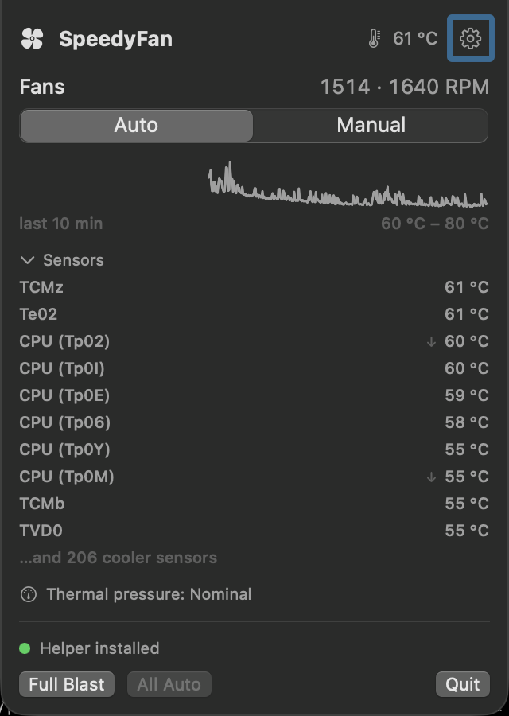

# SpeedyFan

A small macOS menu bar utility for watching and controlling the cooling fans
in Apple Silicon Macs: live RPM and temperatures in a popup panel, each fan —
or all of them linked — switchable between the firmware's automatic control
and a manually pinned speed, with enough supervision that manual control
can't quietly hurt the machine.

<p align="center">
  
</p>

## Features

- **Fan control** — switch any fan between **Auto** (firmware-controlled)
  and **Manual** (fixed RPM, clamped to the fan's own min–max range).
  **Link Fans** (default) drives every fan with one switch and a single
  0–100 % slider mapped onto each fan's own range; turn it off for
  independent per-fan sliders. Sliders apply live while dragging — throttled
  to one hardware write per 300 ms, on a serial queue so writes can't land
  out of order — and one-click **Full Blast** / **All Auto** presets sit in
  the panel footer.
- **Menu bar readings** — any combination of the fan icon, speed in RPM,
  speed as % of maximum, and the hottest sensor temperature, joined by "·"
  and refreshed at an interval you choose (1–20 s). RPM and % report the
  busiest fan. The icon doubles as a state light: *outline* while the
  firmware is in charge, *filled* while a manual pin is active, and a
  *flame* while the heat boost holds — so a pinned fan is visible at a
  glance even with no readings selected.
- **Temperatures** — a hottest-sensor summary, a ten-minute **sparkline**
  (drawn only from polls that actually happened: time spent not polling
  renders as a gap, not an invented ramp), and a collapsible list of the
  individual sensors, each growing a rising/falling trend arrow once ~20 s
  of readings show a direction. Sensor names are best-effort community
  knowledge, keyed by chip generation; anything unnamed shows its raw
  four-char SMC key. Display in Celsius, Fahrenheit, or whatever the
  system region uses.
- **Thermal pressure** — macOS's own heat verdict
  (`ProcessInfo.thermalState`: Nominal / Fair / Serious / Critical) as a
  permanent panel caption, colored from Serious up — the levels where macOS
  itself starts throttling. Unlike a raw sensor reading it bakes in Apple's
  per-model knowledge of what's normal, and it costs nothing: the OS pushes
  changes, so the app never polls for it.
- **Maximum Fans At** (off by default) — a heat response: when the hottest
  sensor reaches a trigger temperature (85–100 °C), every fan is driven to
  maximum — overriding Auto *and* manual pins — and held until the sensor
  cools 10 °C below the trigger.
- **Return to Automatic After** — an optional 15 / 30 / 60-minute timer
  that ends manual control with a notification, with a countdown shown in
  the panel.
- **Launch at Login**, a hideable menu bar icon (session-only, so you can't
  lock yourself out — relaunching or reopening the app always brings it
  back), and accessibility labels throughout the UI.
- **Light on the machine** — with the panel closed and no readings
  selected, the app doesn't poll the SMC at all. The open panel refreshes
  at 1 s, safety supervision (while anything is manual or the boost is
  armed) at 2 s, and the menu bar on its *own* timer at exactly the
  interval you chose, so no faster consumer can drag it along.

## Safety model

Pinning a fan is only worth having if it can't end badly, so supervision is
not optional:

- Manual speeds are always clamped to the fan's own `[min, max]` range.
- A **thermal failsafe** (85–100 °C, default 95) forces everything back to
  Auto, with an alert, if any sensor gets that hot while a fan is under
  manual control. Fans boosted to maximum are exempt — full speed can't be
  under-cooling.
- A **stuck-fan alert** fires when a fan is commanded to a real speed
  (target at or above its own minimum) but reports essentially no rotation
  for 30 s of continuous observation — the one hardware fault a fan app can
  catch early. Observation gaps reset the clock rather than counting time
  nobody measured, and a healthy spin-up never qualifies.
- **Sleep** hands the fans back to the firmware on the way down — the SMC
  keeps its last order through sleep, so a pinned fan would otherwise spin
  at that speed all night, unsupervised — and wake restores exactly the
  speeds that were pinned, or asserts Auto if nothing was.
- **Quit** returns any pinned fan to Auto, and so does the next **launch**
  if a previous session died without cleaning up.
- Temperature-driven automation (the boost) always presents as *Auto* in
  the UI: Manual means a person asked.

Alerts use Notification Center (permission requested on first use). If
notifications are denied, the failsafe and the stuck-fan alert fall back to
a modal dialog; informational messages simply drop. A **Notifications** tab
in the settings window switches each category — safety alerts, the maximum
fans boost, "returned to automatic" — and the notification sound on or off
individually, and shows the macOS permission status. Switching a category
off silences it entirely (the protections themselves still act), and a
*failed* emergency return to automatic always alerts, regardless.

One honest limit: the failsafe runs only while the app does. If the app is
force-killed with fans pinned, relaunch it, run `sudo fanctl auto-all`, or
reboot — SMC state resets on reboot.

## Install

### From a release

Download the `.dmg` from
[Releases](https://github.com/n14395/speedy-fan/releases) and drag SpeedyFan
to Applications. The app is ad-hoc signed (no paid Apple Developer account),
so macOS quarantines it after download: approve it under **System Settings →
Privacy & Security** when first blocked, or clear the flag:

```sh
xattr -dr com.apple.quarantine /Applications/SpeedyFan.app
```

### From source

```sh
./build.sh        # builds SpeedyFan.app and packs SpeedyFan-<version>.dmg
open SpeedyFan.app
```

Building needs full Xcode — the bare Command Line Tools are missing the
SwiftUI macro plugins; `build.sh` finds `/Applications/Xcode.app` or
`Xcode-beta.app` automatically. Every build also packs a versioned,
drag-to-install `.dmg` (the version comes from `CFBundleShortVersionString`
in `Info.plist`). The app icon is generated code-first:
`tools/make-icon.swift` renders it and `build.sh` packs the `.icns` whenever
it's missing. Tests run with `swift test`.

### The privileged helper

Reading the SMC needs no privileges; **writing needs root**. On your first
manual change the app installs its helper CLI (`fanctl`) once to
`/Library/PrivilegedHelperTools/com.speedyfan.fanctl` as setuid-root — one
admin password prompt — after which slider changes apply silently. The
settings window shows the install status and offers an **Uninstall Helper**
button (fans are returned to automatic first).

## Notes on the SMC (hard-won)

SpeedyFan speaks the classic `AppleSMC` IOKit protocol, the same mechanism
used by smcFanControl, Macs Fan Control and exelban/stats. Things learned
the hard way, kept here so nobody has to learn them again:

- The key scheme is `FNum` (fan count) and per fan `F<n>Ac` actual, `F<n>Tg`
  target, `F<n>Mn`/`F<n>Mx` range, `F<n>Md` mode. Values are `flt` on
  M-series (classic `fpe2`/`sp78` are also decoded).
- **`F<n>Md` is a flag word, not a boolean.** Writing 1 forces a fan, but
  firmware can report **3 with a target of 0** for a fan it has *parked*
  itself — blades stopped, the normal cool-idle state and the state a Mac
  wakes in. "Mode is non-zero" therefore does not mean a person asked for
  the current speed: SpeedyFan only treats a fan as manually pinned when it
  is forced *and* its target is at least the fan's own minimum, which a
  park never is and a real pin always is (writes clamp to `[min, max]`).
- **`F<n>Mn` is read-only on Apple Silicon** — writes fail with SMC result
  134 or are silently ignored.
- On some M-series firmwares a mode write only sticks after setting the
  `Ftst` (thermal test) flag; the helper handles that unlock-and-retry
  dance, and clears the flag again on auto-all.
- **Sleep leaves the SMC exactly as it was** — hence the explicit handover
  in the safety model above.
- Temperature sensor keys are undocumented on Apple Silicon, so they are
  discovered by scanning (plausible `T***` keys) rather than listed. An
  M1 Max exposes ~200 of them, and die hotspot sensors idle at 70–80 °C —
  absolute "this is hot" judgments are unreliable, which is why the panel
  also shows macOS's own thermal-pressure verdict. Sensor *names* come from
  the community tables in exelban/stats, selected per chip generation
  because the same key means different sensors on different chips (`Tp09`
  is an efficiency core on M1 but a performance core on M2).

## Command-line tool

The helper doubles as a debug CLI (from the build tree, or as installed at
`/Library/PrivilegedHelperTools/com.speedyfan.fanctl`):

```sh
fanctl list             # JSON fan status (no root needed)
sudo fanctl set 0 4000  # pin fan 0 to 4000 RPM
sudo fanctl auto 0      # fan 0 back to automatic
sudo fanctl auto-all    # everything back to automatic
fanctl key F0Md         # print one raw SMC key (no root needed)
```

## Uninstall

Quit the app first (quitting returns the fans to automatic), then:

```sh
sudo rm /Library/PrivilegedHelperTools/com.speedyfan.fanctl
rm -rf /Applications/SpeedyFan.app
```

## Compatibility

macOS 13 or later. Developed and tested on an M1 Max MacBook Pro; other
Apple Silicon Macs should work. Intel Macs are untested — the SMC layer does
speak the classic data types, so it may largely work, and reports are
welcome.

## Acknowledgements

- The `AppleSMC` user-client protocol follows the lineage of
  [smcFanControl](https://github.com/hholtmann/smcFanControl),
  [SMCKit](https://github.com/beltex/SMCKit) and
  [exelban/stats](https://github.com/exelban/stats).
- Apple Silicon sensor-key names are community knowledge from the
  MIT-licensed [exelban/stats](https://github.com/exelban/stats), which in
  turn draws on [acidanthera's VirtualSMC
  documentation](https://github.com/acidanthera/VirtualSMC).
